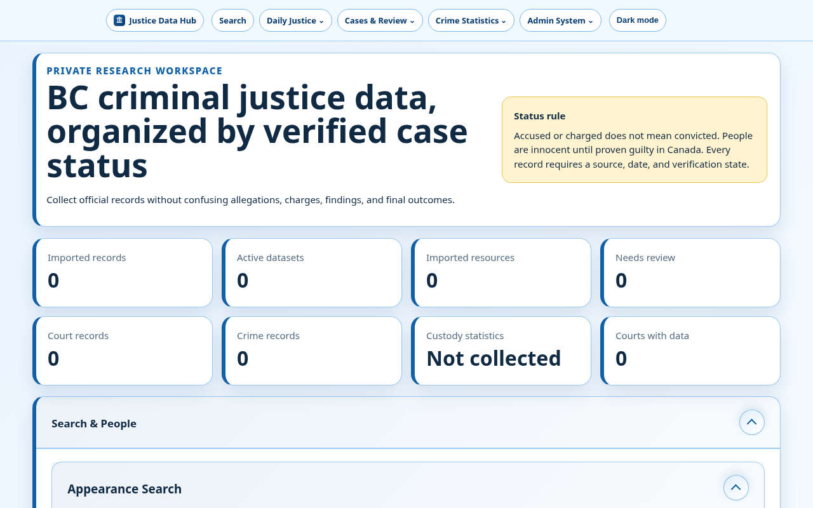

# BC Justice Data Hub v0.20.7



*Headless screenshot of `index.html` served locally (no live data backend; counts reflect bundled/empty local data).*

## v0.20.7 Appearance Search pagination cleanup

- Removed the duplicate Show 50 / 100 selector from the bottom pagination row.
- Page size remains available in the sticky/floating results toolbar.
- Bottom pagination now contains only Previous, page number, and Next controls.

## v0.20.1 Appearance Search usability and performance

- Added Today, Next 7 days, Past 30 days, and All dates shortcut pills.
- Active filters appear as individually removable pills beneath the filters.
- Search filters, sorting, page, page size, detail view, and court-file grouping persist in the URL and support browser Back/Forward.
- Added Compact and Detailed result views.
- Added optional court-file grouping with all matching appearance dates nested beneath each file.
- Added visible charge-confidence badges beside result names.
- Appearance API results now include person-profile match metadata, so the full people index is loaded only if static fallback is required.
- Added a sticky status/sort/page-size toolbar while preserving complete pagination below results.
- Mobile results render as spaced cards instead of a horizontally scrolling table.

## v0.19.9 Appearance Search charge-column layout

- Appearance Search Record details now use a two-column layout on wider screens.
- Appearance, codes, statute, section, date/time, courthouse, courtroom, court file and court level remain in the left column.
- Linked alleged charge, charge confidence and evidence appear in a dedicated right column.
- The layout stacks into one column on smaller screens, and the catalogued-appearances badge remains below the Record details grid.


## v0.19.3 Header dropdown arrow direction

- Header dropdown arrows now rotate clockwise to point upward when a menu opens.
- The arrow span is explicitly transformable with a centered transform origin for consistent animation across browsers.

## v0.19.2 Appearance Search prompt wording

- The Appearance Search name-field placeholder now reads: “Begin typing a name or select a date for results to populate.”

## v0.19.1 Homepage regrouping and header navigation

- Search & People remains first and keeps Appearance Search, Full Index Search, Case and person index, and Repeat-offender review.
- The homepage now uses Search & People, Daily Justice Overview, Cases, Judgments & Review, Crime Statistics, and Admin System.
- Person profiles, relationships, case timelines, linked proceedings, judgments, and review tools are grouped under Cases, Judgments & Review.
- Reports, monitoring, official sources, definitions, privacy, source validation, collection policy and system tools are combined under Admin System.
- Retry Centre is grouped under Admin System.
- Shared and static page headers use Daily Justice, Cases & Review, Crime Statistics, and Admin System while preserving Justice Data Hub, Search, and the theme toggle.

## v0.18.9 Appearance Search notice consolidation

- Removed the separate scheduled-appearance warning line from the shared Appearance Search renderer and standalone page.
- Added the same legal-status notice to the end of the Appearance Search introductory description.
- Homepage and standalone Appearance Search now use matching introductory wording.


## v0.18.8 Appearance Search definition links

- Appearance code, status code, statute, and section values now link to code-specific anchors on the Data Dictionary page whenever a value is available.
- Known statute codes display their stored full definition.
- Unknown appearance and status codes open a cautious code-specific definition card instead of assigning an unverified meaning.
- Code-specific dictionary cards link to the official JUSTIN code table when an exact local definition is unavailable.
- Section definitions display the recorded statute and section while preserving the allegation-not-proven warning.


## v0.18.4 Appearance Search record layout

- Appearance Search results now keep only the Name and Record details columns.
- Record details begin with Appearance, appearance code, status code, statute, and section, followed by date/time, courthouse, courtroom, court file, and court level.
- Linked alleged charge, charge confidence, and evidence follow the court details.
- The existing catalogued-appearances history badge remains unchanged at the bottom of each record.
- Person profile actions and conditional data-quality flags remain with the highlighted name.

## v0.18.3 Appearance Search sorting

- Added a shared Sort results control to the homepage and standalone Appearance Search.
- Newest appearance remains the default.
- Available orders are oldest appearance, name A–Z, courthouse A–Z, strongest charge confidence first, and most catalogued appearances.
- SQLite API and static JSON fallback use matching sort rules, including full-result exports and pagination.

## v0.18.2 Homepage search-expander default

- Search & People still opens by default.
- Appearance Search still opens by default.
- Full Index Search now remains closed on initial page load and opens only when selected or linked by its URL hash.

## v0.18.0 Appearance Search export controls

- Restored the CSV, JSON, and printable-report pills in the shared Appearance Search renderer.
- Export pills are always visible directly below the filters and centered on both Appearance Search locations.
- Pills remain disabled until matching records are available, then export the complete filtered result set.

## v0.17.9 Appearance Search browser caching

- Static Appearance Search JSON uses conditional browser caching instead of forced full redownloads.
- IIS ETag or Last-Modified validation refreshes regenerated exports while allowing unchanged catalogue pages to return from cache.
- Dynamic loopback Search API responses remain uncached so live filters, counts, history and exports stay current.

## v0.17.8 Appearance Search API and pagination

- Appearance Search now queries a dedicated loopback SQLite endpoint instead of downloading the full court-list catalogue before each search.
- Results render 50 records by default with Previous, Next, page count, and 50/100 page-size controls.
- CSV, JSON, and printable exports still include the entire filtered result set.
- Static paged JSON remains an automatic fallback when the local Search API is unavailable.
- The daily court-list export refreshes the normalized SQLite appearance-search cache used by the API.

## v0.17.7 relationship and notes results

- Relationships now joins case, person, mention, court-list, and judgment indexes into useful linked-matter cards.
- Private Notes fallback now points to both the notes export command and Export actions button.

## v0.17.7 results-area reliability
- Repaired courthouse-map empty and error states.
- Relationship results now include matters originating from court lists or judgments, not only CSO cases.
- Repeat-offender results clear stale rows and show a visible empty state when the index is unavailable.
- Added broad JavaScript parsing and results-area regression checks.

## v0.17.7 legacy alias migration

- Existing `person_aliases` tables are upgraded in place before person-index rebuilding.
- Legacy `alias_text` records remain compatible with the newer `alias_name`, provenance, verification and confidence fields.
- Alias inserts now use the deployed table's stable person/name uniqueness rule, preventing `person-identity.cmd` export failures.

Private IIS-compatible workspace for collecting, reviewing, searching and reporting on official British Columbia justice data.

For the consolidated project overview, see [`SITE_SUMMARY.md`](SITE_SUMMARY.md).

## v0.17.7 chart datasets
- Replaced the old indexed case-category chart with three nested chart/table expanders.
- Court activity groups current scheduled appearances and distinct court files by courthouse and month.
- Verified outcomes count only explicitly verified convictions, acquittals, stays, dismissals and withdrawals.
- Crime severity and offence-rate charts use aggregate Statistics Canada or normalized crime statistics.
- Court-list appearances remain separate from charges and convictions.

## Deployment

```text
C:\inetpub\wwwroot\sites\bcjus
```

Extract release ZIPs over the existing site folder. Do not delete the deployed folder first because runtime databases, imports, reports, backups and generated JSON must remain intact.

## Normal operation

```bat
tools\collect-new.cmd
```

The command asks `Y/N` before creating a database backup. Press `Y` to back up and continue or `N` to continue without a backup; no Enter key is required. Only the newest database backup is retained.

Full forced refresh:

```bat
tools\collect-all.cmd
```

Numbered command launcher:

```bat
command.cmd
```

## Major capabilities

- Official-source collection with hashes and provenance
- SQLite source-of-truth database and FTS5 search
- Split cached search indexes for cases, people, judgments and statistics
- Weighted exact-match ranking, aliases, synonyms, filters and query interpretation
- Case, person, charge, event, sentence and outcome normalization
- Judgment verification and auditable CSV review actions
- Stable person identities, aliases and confidence signals
- Repeat-offender analysis across any verified offence type or legislation
- Historical judgment backfill and prior-record extraction
- Police, corrections, prosecution, court, crime and statistics dashboards
- Courthouse directory, map and daily appearance indexing
- Charts, comparisons and printable reports with Excel/PDF exports
- Source validation, retry centre, system health, storage and scheduling tools

## Important commands

```bat
tools\setup.cmd
tools\collect-new.cmd
tools\collect-all.cmd
tools\collect-justice.cmd
tools\collect-historical-judgments.cmd
tools\person-identity.cmd
tools\apply-reviews.cmd review-actions.csv
tools\maintenance.cmd
tools\system-health.cmd
```

See `commands.txt` for the complete synchronized command list.

## Data and review safeguards

- Same-name records are not merged automatically.
- Confirmed repeat offending requires at least two distinct verified conviction events.
- Accused, charged, convicted, acquitted, stayed, withdrawn and dismissed outcomes remain distinct.
- Historical and uncertain extracted records remain review-required.
- Runtime data is excluded from release ZIPs.

## Primary runtime locations

```text
database\bc_justice.db
backups\database\
imports\
reports\
data\*.json
```

## Rebuilds

Refresh the full site data:

```bat
tools\collect-new.cmd
```

Rebuild person identities and repeat-offender profiles:

```bat
tools\person-identity.cmd
```

Backfill historical decisions:

```bat
tools\collect-historical-judgments.cmd
```

## Person-focused search improvements

See SITE_SUMMARY.md.

### Person matching refinements
- Given names and surnames are scored independently, with exact surname matches weighted above phonetic surname matches and exact given-name matches weighted above phonetic given-name matches.
- Middle-name disagreements now distinguish missing information, initial conflicts, and full middle-name conflicts.
- Published ages are checked against judgment dates to identify impossible age timelines.
- Shared courthouse and location history contributes cautious supporting evidence and is exposed in person search records.


## Person-focused search and profile controls

- Permanent pair-level identity decisions survive index rebuilds and retain evidence notes, reviewer and source metadata.
- Full Search includes a dedicated People-only mode that loads the person index and links directly to permanent profiles.
- Person profiles support search-within-person filters for free text, year, legislation, court/location and outcome, including sentence text.

## Repeat-offender strengthening in v0.8.4

- Links appeals, sentencing decisions, retrials, and related court files to the underlying conviction event when supported by explicit case links, matching files, citations, or offence dates.
- Separates conviction events primarily by occurrence/event identifiers and offence dates.
- Adds confirmed, likely, reported-history, and review-required confidence modes.
- Adds historical coverage indicators: strong, partial, recent years only, judgment-reported history only, or unknown.
- Flags missing history when a judgment reports more prior convictions than are independently indexed or describes a substantial record.
- Exports a chronological conviction sequence with gaps, linked proceedings, offence groups, and conviction dates.
- Confirmed repeat status still requires at least two distinct independently verified conviction events.


## v0.8.4 homepage organization

The main page uses five top-level expanders: Search & People, Daily Justice Overview, Cases, Judgments & Review, Crime Statistics, and Admin System. Search & People and Daily Justice Overview open by default; reporting, governance and technical administration are consolidated under Admin System.


## Name recurrence analysis

Repeat-offender exports include a separate `repeat_appearances_only` tier derived from recurring normalized names across distinct court-list dates or file numbers. These records are review-only and are never counted as convictions or confirmed identities.

## v0.8.4 safeguard hardening
- Daily court files now keep stable source identities and separate stored versions so corrected source files do not overwrite prior versions.
- Daily-court appearances keep historical rows, current-row flags, and supersession links.
- Daily-court exports now write paged JSON files when needed, instead of silently truncating beyond 10,000 rows.
- Statistics Canada and police imports now replace source rows inside savepoints so a bad refresh rolls back cleanly.
- Generated JSON snapshots now write atomically and keep `.bak` last-known-good copies.
- Verified-judgment replacement now snapshots prior case_people, charges, and outcomes into `case_record_history` before replacement.
- Added `tests/data_retention_tests.py` and `tools\test-data-retention.cmd`.

## v0.8.4 fixes
- Historical judgment collection now waits and retries when SQLite is temporarily busy, uses a 60-second busy timeout, and enables WAL mode when available.
- Homepage nested expander arrows now rotate only for the expander that was clicked.
- The category chart now includes normalized cases plus distinct current criminal court-list file/date records, clearly labelled as scheduled records rather than convictions.
- Custody normalization now recognizes custody/corrections datasets from catalogue titles and resource names, not only keywords inside each data row.
- The homepage distinguishes `Not collected` and `Needs extraction` from a real zero custody-statistics count.

## Live search architecture (v0.8.4, no version change)
- `tools\start-search-server.cmd` starts a loopback-only SQLite/FTS5 API.
- `search.html` prefers live database search and automatically falls back to generated JSON.
- Search records are incrementally upserted by content hash; unchanged rows are not re-indexed.
- Current, superseded, and all-version court-list filters are available.
- Search status shows source mode, indexed count, freshness, changed rows, and removed rows.
- Results are paginated at the search source in groups of 25.


## Completed search architecture
- Loopback SQLite/FTS5 API with 25-result source pagination and JSON fallback.
- Cross-source grouping by court file, citation, case identity and location.
- Expandable provenance showing source table, document/version identifiers, index time, verification and record status.
- Statistics-specific dataset, metric, geography, period and unit filters.
- Persistent courthouse alias registry generated from official and indexed courthouse/location names.
- Automated search-quality tests for grouping, provenance, aliases, superseded filtering and statistics facets.


## v0.8.4 cleanup baseline

- Audited all HTML links, local assets and script references; no broken references remain.
- Confirmed every JavaScript file is actively referenced and retained intentional responsive CSS overrides.
- Removed generated Python cache files from the release tree.
- Revalidated all Python modules, JavaScript syntax and regression tests.
- Synchronized all 31 command files with the command lists and homepage Commands expander.
- Preserved runtime-data exclusions for databases, backups, generated data, reports and live imports.

## v0.8.4 incremental collection optimization

- Statistics Canada sources now use `HEAD`, `ETag`, `Last-Modified`, `Content-Length`, conditional requests, and stored SHA-256 values before downloading.
- Unchanged tables skip download, archive validation, CSV extraction, and database replacement.
- `tools\collect-new.cmd --quick` skips unnecessary downstream rebuilds when no database-size change is detected.
- `tools\collect-new.cmd --force` deliberately redownloads and reimports supported sources.
- Catalogue synchronization supports the same `--quick` and `--force` controls.
- Temporary Statistics Canada ZIP files are deleted after successful import; extracted CSV files are not retained.

## v0.17.7 person collection completion
- Central person mentions now harvest conservative, source-backed names from normalized cases, court lists, judgments, police reports, prosecution reports, and corrections oversight documents.
- Source variants are retained in a person alias registry and included in person-search exports.
- Low-confidence or unknown-role extractions enter the review queue instead of being silently promoted.
- Person collection metrics are exported to `data/person-collection-metrics.json`.
- Duplicate-person scoring now considers shared court files and court/location history.
- Raw mention context remains searchable while legal status and verification remain separate fields.


## v0.20.7 Collect New identity-aware post-processing

- Collect New snapshots identity inputs before collection and rebuilds person identities only when people, aliases, appearances, cases, judgments, outcomes, charges, or identity decisions changed.
- Collection publishes initial exports first, reports “Collection is complete,” then launches required post-processing automatically in a separate process by default.
- `tools\collect-new.cmd --wait` keeps the command open until person identities, advanced features, and final exports finish.
- Statistics-only changes skip `person_identity.py` and run only non-identity advanced stages.
- `data/post-processing-status.json` and `reports/identity-postprocess-latest.log` record background progress and failures.

## v0.20.7 charge-confidence definitions

- Charge confidence now has dedicated Data Dictionary entries and direct anchors for Confirmed, Likely, Possible, Non Verified, and Charge Not Available.
- Charge Not Available means no charge record is currently linked in the local index; it is not a finding that no charge existed.
- The Name column uses the same Charge Not Available confidence badge and definition; no separate Charge unavailable warning is shown.

### v0.20.7

- Merged the separate Name-column “Charge unavailable” warning into the existing “Charge Not Available” confidence badge.
- Appearance Search now displays one Charge Not Available indicator linked to `#charge-confidence-not-available`.
- Removed the separate visible `#charge-unavailable` Data Dictionary entry.

---

Built by [Trevor Heshka](https://trevorheshka.com).
